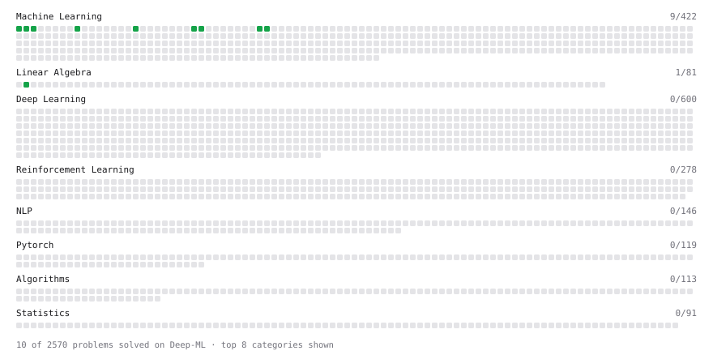

# Deep-ML

My machine learning practice from [Deep-ML](https://www.deep-ml.com). Every solution here was written by hand.

**10** solved · 9 problems · 0 labs · 1 math

[**Browse the interactive portfolio**](https://AbuHajaarf.github.io/deep-ml/) to replay this filling in over time.

## Problems

| | Difficulty | Solved | |
| --- | --- | --- | --- |
| [Binary Classification with Logistic Regression](https://www.deep-ml.com/problems/104) | easy | 2026-11-19 | [solution](problems/0104-binary-classification-with-logistic-regression) |
| [Calculate Mean Absolute Error (MAE)](https://www.deep-ml.com/problems/93) | easy | 2026-11-20 | [solution](problems/0093-calculate-mean-absolute-error-mae) |
| [Calculate R-squared for Regression Analysis](https://www.deep-ml.com/problems/69) | easy | 2026-11-18 | [solution](problems/0069-calculate-r-squared-for-regression-analysis) |
| [Calculate Root Mean Square Error (RMSE)](https://www.deep-ml.com/problems/71) | easy | 2026-11-20 | [solution](problems/0071-calculate-root-mean-square-error-rmse) |
| [Feature Scaling Implementation](https://www.deep-ml.com/problems/16) | easy | 2026-11-20 | [solution](problems/0016-feature-scaling-implementation) |
| [Implement Ridge Regression Loss Function](https://www.deep-ml.com/problems/43) | easy | 2026-11-18 | [solution](problems/0043-implement-ridge-regression-loss-function) |
| [Linear Regression Using Gradient Descent](https://www.deep-ml.com/problems/15) | easy | 2026-11-18 | [solution](problems/0015-linear-regression-using-gradient-descent) |
| [Linear Regression Using Normal Equation](https://www.deep-ml.com/problems/14) | easy | 2026-11-18 | [solution](problems/0014-linear-regression-using-normal-equation) |
| [Random Shuffle of Dataset](https://www.deep-ml.com/problems/29) | easy | 2026-11-22 | [solution](problems/0029-random-shuffle-of-dataset) |

## Math

| | Difficulty | Solved | |
| --- | --- | --- | --- |
| [Vector Operations](https://www.deep-ml.com/math-problems/7) | easy | 2026-11-23 | [solution](math/0007-vector-operations) |

---

_This file is regenerated by Deep-ML on every push._
